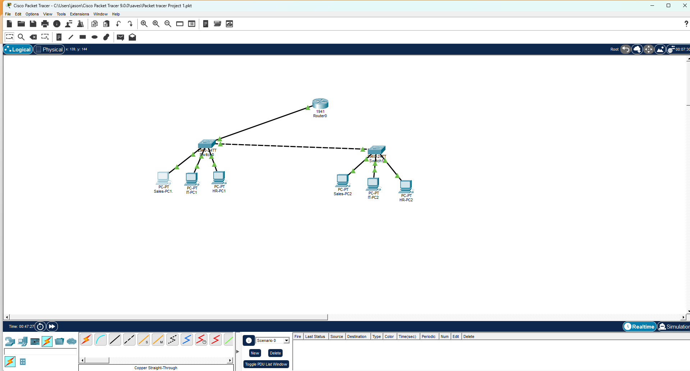
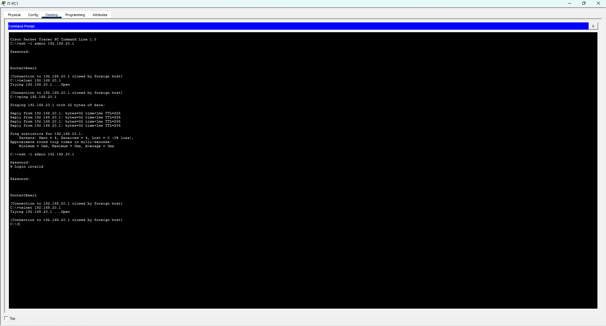
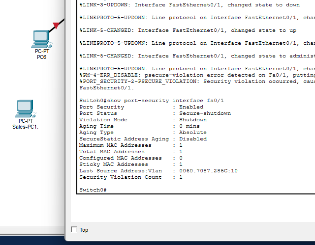

# Secure Small Business Network (Cisco Packet Tracer)

A segmented, hardened small business network built from scratch in Cisco Packet Tracer. The network has three departments (Sales, IT, HR) on separate VLANs, with inter-VLAN routing, DHCP, SSH-only management, access control lists, and port security.



## Skills Demonstrated

- VLAN segmentation and 802.1Q trunking
- Router-on-a-stick inter-VLAN routing
- DHCP server configuration on a Cisco router
- SSHv2 with local authentication (Telnet disabled)
- Standard and extended ACLs
- Port security with sticky MAC learning
- Switch hardening (unused ports disabled and isolated)

## Topology

| Device | Model | Role |
|---|---|---|
| Router0 | Cisco 1941 | Inter-VLAN routing, DHCP, ACLs |
| Switch0 | Cisco 2960 | Access switch, uplink to router |
| Switch1 | Cisco 2960 | Access switch, trunked to Switch0 |
| 6 PCs | PC-PT | Two per department |

**Cabling:** straight-through for router-to-switch and PC-to-switch links, crossover for the switch-to-switch link.

## IP Addressing Plan

| Department | VLAN | Network | Gateway | DHCP Range |
|---|---|---|---|---|
| Sales | 10 | 192.168.10.0/24 | 192.168.10.1 | .11 – .254 |
| IT | 20 | 192.168.20.0/24 | 192.168.20.1 | .11 – .254 |
| HR | 30 | 192.168.30.0/24 | 192.168.30.1 | .11 – .254 |
| Unused ports | 999 | Black hole VLAN | — | — |

**Management IPs (IT VLAN):** Router0 `192.168.20.1`, Switch0 `192.168.20.2`, Switch1 `192.168.20.3`

## Switch Port Assignments

| Ports | VLAN | Status |
|---|---|---|
| Fa0/1 – Fa0/10 | 10 (Sales) | Fa0/1 active, rest shut down |
| Fa0/11 – Fa0/20 | 20 (IT) | Fa0/11 active, rest shut down |
| Fa0/21 – Fa0/24 | 30 (HR) | Fa0/21 active, rest shut down |
| G0/1 – G0/2 | Trunk | Uplinks |

## Security Controls

### 1. SSH-only remote management
SSHv2 is enabled on the router and both switches with local user authentication. The VTY lines use `transport input ssh`, so Telnet connections are dropped before authentication.

### 2. Access control lists
- **SSH-ONLY-IT** (standard ACL on the router's VTY lines): only the IT subnet can open management sessions.
- **BLOCK-SALES-TO-HR** (extended ACL inbound on G0/0.10): Sales cannot reach HR, which protects sensitive employee data. All other traffic is permitted.

### 3. Port security
Each active access port allows one MAC address, learned with sticky MAC. A violation puts the port into err-disabled (shutdown) mode.

### 4. Unused port hardening
All unused switch ports are assigned to black hole VLAN 999 and administratively shut down to reduce the attack surface.

## Testing and Verification

| Test | Expected Result | Outcome |
|---|---|---|
| All PCs request DHCP | Each receives an IP in its department subnet | ✅ Pass |
| Sales-PC1 pings HR-PC2 (before ACLs) | Replies with TTL 127 (routed) | ✅ Pass |
| IT-PC1 SSH to router and switches | Login succeeds | ✅ Pass |
| IT-PC1 Telnet to router | Connection closed, no login prompt | ✅ Pass |
| Sales-PC1 pings HR-PC2 (after ACLs) | Blocked | ✅ Pass |
| Sales-PC1 pings an IT PC | Succeeds | ✅ Pass |
| Sales-PC1 SSH to router | Blocked (not IT) | ✅ Pass |
| Rogue PC plugged into Fa0/1 | Port goes Secure-shutdown, violation count 1 | ✅ Pass |
| Original PC reconnected after recovery | Connectivity restored | ✅ Pass |

### Screenshots

**SSH succeeds, Telnet is rejected**


**ACL blocking Sales from HR and from SSH**


**Port security catching a rogue device**


## Files

| File | Description |
|---|---|
| `SecureSmallBusinessNetwork.pkt` | Packet Tracer project file |
| `Router0-config.txt` | Router running configuration |
| `Switch0-config.txt` | Switch0 running configuration |
| `Switch1-config.txt` | Switch1 running configuration |

> **Note:** This is a lab environment. Passwords in the config files are lab-only placeholders and are not used anywhere else.

## Key Commands

```
! Router-on-a-stick subinterface
interface g0/0.10
 encapsulation dot1Q 10
 ip address 192.168.10.1 255.255.255.0

! SSH only on VTY lines
line vty 0 4
 transport input ssh
 login local
 access-class SSH-ONLY-IT in

! Port security
interface fa0/1
 switchport port-security
 switchport port-security maximum 1
 switchport port-security mac-address sticky
 switchport port-security violation shutdown
```

## Future Improvements

- Add a dedicated management VLAN separate from user traffic
- Configure DHCP snooping and Dynamic ARP Inspection
- Add a syslog server and NTP for centralized logging
- Add redundancy with a second router and HSRP
